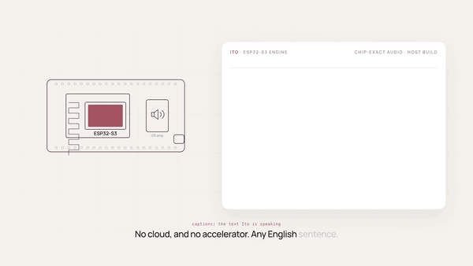

# Ito: natural-sounding streaming text-to-speech for a $5 chip

[](https://lokutor-ai.github.io/ito/)

*Click the animation to watch the 50-second video **with sound** (the GIF is silent). Every voice in it is Ito's own output from the chip engine.*

Ito is English text-to-speech whose neural model runs entirely on an **ESP32-S3** (240 MHz dual-core Xtensa LX7, 8 MB PSRAM, 16 MB
flash), with no cloud and no neural accelerator. **Since v1.1.0 (5 November 2026) the text front end runs on the chip too:** you give the chip English text
(`text Good morning!` on its serial console, or a phrase list stored in flash) and it normalizes it, phonemizes it with a port of espeak-ng 1.52.0 and
synthesizes it, with no computer in the loop; it was tested stand-alone with nothing on the serial port (see the table below for what was and was not measured). Sending phoneme ids from a computer
(`esp32/tools/say.py`) still works and is the host alternative; the older speed figures below were measured that way, so they start at the ids.
It streams: audio starts after a short first chunk (125 ms of audio) is ready, and the work
before it does not grow with the sentence length. The voice is distilled from a large open TTS model into 3.3 M parameters. Built by
[Lokutor](https://lokutor.com), the makers of [Oído](https://github.com/lokutor-ai/oido) (speech recognition on the
same chip).

> **Text in, speech out on the chip (v1.1.0, measured 4 and 5 November 2026 on one ESP32-S3-DevKitC-1 N16R8, rev v0.2; a different board from the one of the headline below; firmware `onchip-frontend`, image `esp32/prebuilt/ito_app_frontend_merged.bin`; female voice, full split, int4 set chosen by the boot, ESP-IDF 5.5.1).** The chip turns English text into the exact token ids the host front end produces, then into audio, and nothing else is needed. Everything in this table was measured on silicon; nothing was estimated. Full tables, commands and limits: [`esp32/FRONTEND.md`](esp32/FRONTEND.md).
>
> | | Result |
> |---|---|
> | Ids from the chip vs the Python front end (phonemizer 3.6.0, nltk 3.10.4, espeak-ng 1.52.0) | **2004 of 2004 texts identical** (1403 tuning corpus + 601 fresh texts: URLs, e-mail, numbers, dates, typos, names), 527 of 527 in say.py-exact mode |
> | PCM from the chip vs the host C engine, same ids and seed | **1661 of 1661 utterances bit-identical** |
> | Front end alone (2380 utterances, `ids`) | median 6.8 ms, p95 26.5, p99 36.3, max 58.5 (about 1.0 + 0.097 ms per id); init at boot 8 ms |
> | **Text typed -> first 125 ms audio chunk computed**, full split, int4 set (36 texts of 5 to 247 words, 154 utterances) | **median 188.8 ms, p95 196.7, max 199.2; 36 of 36 under 200 ms**; RTF 0.654, 0 underruns |
> | same, 500 short texts (2 to 9 words) / stand-alone run (240 texts, by first-utterance length) | median 183.2 ms, 490 of 490 under 200 ms / median 185.6 ms, 220 of 240 under 200 ms (0 to 150 ids: 208 of 208) |
> | same, int8 main set | median 193.2 ms, p95 201.1, max 203.3; 32 of 36 under 200 ms |
> | same, **row split** (the fallback of a board whose supply fails the test) | **240 to 250 ms**, 0 of 16 under 200 ms; RTF 0.84 to 0.86, 0 underruns |
> | Long first sentences (over about 150 ids, roughly 20 words) | 203 to 217 ms (231 to 339 ids); 252 to 285 ms if the first piece exceeds the engine's 400-token limit and has to be split |
> | Stand-alone run: no computer attached while it ran | 240 texts never seen before (1 to 150 words, 20 paragraphs), **748 utterances, 5448 s of audio, 748/748 ids and 748/748 PCM identical to the host, 0 underruns**, RTF 0.654 (0.642 to 0.678); the chip read its own text from flash and logged to flash, nobody opened the serial port while it ran (it was interrupted once by reading the log back and resumed by itself) |
> | 20-boot loop with software and deliberate watchdog resets | 180 of 180 utterances identical; every boot passed the bit-exact self-test |
> | Robustness | 1200 hostile inputs over serial (random bytes, invalid UTF-8, 20 kB lines, Unicode, control codes): 0 crashes, hangs or resets; 579 utterances: free memory unchanged (no leak) |
> | Memory of the front end | about 273 KB of flash (data inside the app image; app image 948 KB of its 2 MB slot), about 0.36 MB of PSRAM, about 0 internal SRAM; its stack peaked at 45.8 of 64 KB |
>
> **How to read it.** "Text -> first chunk" runs from the end of the text line to the first 125 ms of PCM sitting in memory, as the chip's own timer measures it; it includes normalization, phonemization, queueing and the engine, and excludes the serial transfer of the text and the I2S/DAC stage. The front end of sentence 2 and later runs in the background and did not slow the synthesis (RTF 0.655 against 0.652).
> **Caveats.** One board, one chip revision, USB powered from a Mac, female voice, English only. **No I2S output was ever started in these runs** (`textq`, `textp` and the stand-alone mode compute the audio and hash it; no DAC or amplifier was attached): the DAC path, the audio itself and any listening are not part of these measurements. Not tested: battery, a cold power-up from zero volts, a true unplug (the stand-alone run had no serial reader and no host-side computation, but the board stayed on the Mac's USB 5 V), a second board for the front end, runs longer than the 91-minute stand-alone run. The 183 to 199 ms figures are for sentences of about 20 words or fewer on the full split with the int4 set; the row split is 240 to 250 ms. Limits: one line of at most 4 KB per `text`, at most 2400 bytes per utterance after normalization and 400 tokens for the engine, a single "word" over 2400 bytes gives an error, and the next `text` is refused (not queued) while one is being processed.

> **Headline: the firmware adapts to the board (measured 3 November 2026, one ESP32-S3-DevKitC-1 N16R8, female voice, firmware `fbb900f`, full table in `esp32/BENCHMARKING.md`).** Ito runs its int8 GEMM either on both cores (the **full split**) or on core 0 only with the row loops on both cores (the **row split**); both give the same audio, bit for bit. At boot the firmware runs a 3-second supply self-test on its own kernels and keeps the verdict in flash.
> - **On a board whose supply passes the test, it runs the full two-core split. On this board (female voice, the int4 set the boot chose): the first audio chunk is ready 180 ms after the phoneme ids reach the engine, the real-time factor is 0.65 (0.651 on the calibration sentence, 0.649 to 0.658 on the demo sentences), the planned gap-free start is 222 to 224 ms, and there were 0 underruns** (n = 10 silent runs per sentence, every PCM hash equal to the host C engine's). The same board with the main int8 set: 184 ms, RTF 0.665, planned start 250 ms.
> - **On a board that does not pass the test, or after any brownout, hang or hash failure, it falls back to the row split** (measured on this same board by forcing it): first chunk 231 ms, RTF 0.83 (0.825; demos 0.822 to 0.836), planned start 513 to 615 ms, 0 underruns (main set: 236 ms, RTF 0.84, planned start 509 to 696 ms). A hang is recovered by a hardware watchdog; the full split stays off until `split auto|row|full` says otherwise.
> - **What "first chunk" means:** 125 ms of audio computed and sitting in memory, counted from the phoneme ids (these figures were measured with ids sent from a computer; the on-chip text front end adds 2 to 20 ms, see the table below); the audio output stage and DAC latency are not included. The planned start is when the firmware begins playing so that the speech has no gap.
> - **Weight sets per voice.** The boot measures all three sets and picks the one with the lowest planned start delay among the sets judged equivalent by ear *for that voice*: male main, int4 and light (checked informally by ear by the owner; the male voice has not been blind-tested); female main int8 and int4. The female light set is not on the list: its objective check is clean (UTMOS22 -0.013, UTMOSv2 -0.059, DNSMOS +0.028 against main, identical WER and CER on 54 prompts) but nobody has listened to it, so it is used only if no listed set meets the speed target, until it is approved (`equiv light on` or `CONFIG_ITOFS_APPROVE_LIGHT=y`). Male voice on this board: the light set, first chunk 168 ms, RTF 0.61, planned start 168 ms.
> - **Caveats.** One board, one session; every boot was a reset (USB, software, watchdog); no cold power-on boot has been logged yet. A second ESP32-S3 board (the authors' measurement, Guillermo's) hangs in the full split because its 3.3 V supply collapses, and runs the row split at RTF about 0.84 with 24-frame chunks; that is the case the fallback exists for. Not measured: the output stage and DAC latency, anything acoustic, listening, power draw, other supplies and temperatures. The prebuilt image is built with ESP-IDF 5.5.1 (the previous one with 5.5.5); two builds in different directories are byte-identical. Details: [`esp32/DUAL_CORE_POWER.md`](esp32/DUAL_CORE_POWER.md), [`esp32/BENCHMARKING.md`](esp32/BENCHMARKING.md).
> - **Silent boot and the ES8388 audio shield.** The board boots silent. The default build outputs plain I2S (GPIO15/16/17) and never touches I2C or the master-clock pin; for the ESP_S3-AUDIN shield build with `CONFIG_ITOFS_AUDIO_ES8388=y` (I2C SDA GPIO14 / SCL GPIO47, I2S MCLK GPIO8 / BCLK GPIO3 / LRCK GPIO9 / DOUT GPIO46, verified by an I2C scan and by recordings); `volume <0-100>` sets the output (91 = 0 dB; 0 mutes the DAC for good). See [`esp32/README.md`](esp32/README.md).

> **First run on a physical board (8 October 2026):** the first public prebuilt image crash-looped on first boot on real hardware: its GDMA self-test overflowed a heap buffer, which QEMU cannot show. That run found four first-silicon bugs (the GDMA self-test heap overflow, bench scratch fragmentation, underrun accounting, USB console input), fixed in `fedbd26` (with the notes in `e196730`). The prebuilt image in this repository is the fixed one, and the logs of the crashing runs are kept in `esp32/logs/board_crash_*.log`. The measured numbers below come from the fixed image.
>
> **Status (9 October 2026).** The on-chip engine is verified on a laptop and in Espressif's QEMU emulator: the firmware's audio is bit-identical to the host build of the engine, and every sample in [`samples/`](samples) is that engine's exact output. On the physical board the same self-test also passed: the chip's audio is bit-identical to the host C engine (134100 samples).
>
> **Measured on a board** (ESP32-S3-DevKitC-1 N16R8 (rev v0.2, 8 MB octal PSRAM at 80 MHz, 16 MB flash, 240 MHz), 8 October 2026, firmware fedbd26, female voice): with the main int8 set the first audio chunk (125 ms of audio) was computed and ready 184 ms after the phoneme ids were handed to the engine (in that run the ids came from the host, so no front end is included; for text in see the on-chip text table above) (183.9–184.3 ms over the three demo sentences), and the real-time factor with the full split was 0.66 on the boot calibration sentence (0.660–0.674 on the demo sentences). Gap-free playback is a separate number: the firmware plans to start playback about 246 ms after the phoneme ids arrive, and with that planned delay the three demo sentences had 0 underruns. No DAC or amplifier was attached and no audio was listened to, so the I2S/DAC output stage is not included, these are not acoustic measurements, and the underrun count is the firmware's own accounting against its playout clock. On this board, with nothing else running and I2S idle, synthesis ran faster than real time (RTF 0.66), with 0 underruns when playback starts after the planned 246 ms delay; this is a measurement on one board, not a guarantee. For the female voice, the other two weight sets were timed by hand once on 8 October with the `tier` serial command (one run each, not chosen by the boot calibration): main int4 set RTF about 0.65, first chunk about 180 ms; light set RTF about 0.61, first chunk about 168 ms. **Update, 9 October 2026** (same board, same firmware fedbd26, still no DAC and nothing listened to). Male voice: the boot calibration chose the main int8 set (RTF 0.659 on the calibration sentence, in both of two boots), the bit-exact self-test passed (137,400 samples, identical to the host C engine), the first audio chunk was ready in 183.8–184.8 ms over the demo sentences, the demo-sentence RTF was 0.659–0.672, the firmware planned a gap-free start 248–249 ms after the phoneme ids arrive, and underruns were 0. The male voice's other two sets were timed by hand with `tier` (not boot-chosen; the firmware plans no start delay for hand-timed sets), demo sentences only: main int4 set first chunk 179.5–179.8 ms, RTF 0.645–0.653 (two passes); light set first chunk 167.9–168.0 ms, RTF 0.606–0.613 (one pass); the self-test passed with each set. Female voice, repeats: the same image booted four times in all (8 October and three times on 9 October, each after a USB-serial or watchdog reset, not a cold power cycle); the first chunk was ready in 183.5–184.5 ms over all demo runs, the boot-calibration RTF was 0.660–0.661, the planned start was 246–248 ms, the bit-exact self-test passed every time and underruns were 0. After a demo the PSRAM peak was 5372 KB (female) and 5380 KB (male) of 8192 KB, and internal SRAM 354 of 374 KB (high-water mark after the boot benchmark, 332 KB during the self-test, before any I2S DMA buffers; stack high-water marks were not printed). All of this comes from one board: the repeats and the male runs show repeatability on one chip, not a second board. Against the pre-board estimates (optimistic / central / pessimistic: RTF 0.43–0.47 / 0.63–0.66 / 0.97–0.99, first audio chunk 124–132 / 171–180 / 251–260 ms), the measured RTF of 0.66 is at the top of the central estimate and far from the pessimistic one (0.97–0.99), and the measured first chunk of 184 ms is slightly above the central estimate and below the pessimistic one. Still not measured: audio through a DAC and any listening to the output (no DAC was attached), a second board or a second chip revision, cold power-on boots (every boot was a reset), power draw, long-run thermal behaviour and supply sensitivity, stack high-water marks (not printed), the male voice's sound quality through the chip (its audio is bit-identical to the host engine: self-test PASS), and a planned start delay for the hand-timed sets (the firmware plans none). Still estimates: the optimistic, central and pessimistic columns, which are the pre-board predictions kept for comparison. In the boot benchmark the PSRAM-to-SRAM copy ran at 86.0 MB/s (above the 40–80 MB/s the estimates assumed), GDMA at 36.4 MB/s (slower than a plain copy), cached PSRAM reads at 89.2 MB/s. The firmware therefore stages weights with `direct` reads, the fastest of the four modes it benchmarks (mean RTF 0.66, GEMM 1.060 GMAC/s). The vocoder is 192 wide instead of 256; in a blind test (#10, one listener) it sounded the same as the 256-wide one. The engine starts with a 125 ms first chunk and a short ramp so that playback can start with the first chunk without a gap. An earlier version of this page claimed 130–210 ms and real time at 0.5–1 GOPS; that was too optimistic (see [`esp32/README.md`](esp32/README.md) §4a and §4).
>
> **The firmware checks real time by measurement.** Each voice ships three weight sets (main int8; main with int4 blocks; a light set with one block fewer): at boot the board measures the real time of every chunk with each set, keeps the first whose measured RTF is at most 0.85, plans the playback start delay from those measurements, and prints `WARNING: DEGRADED` (and sets a flag) if even the fastest set measures 0.95 or more. On this board the boot calibration chose the main int8 set with a measured RTF of 0.66 (status OK, degraded flag 0; main int4 and light were not needed, so the boot did not time them; they were timed by hand afterwards). The male voice's boot calibration also chose the main int8 set (RTF 0.659, both male boots), and so did all four female boots. This is a check by measurement on the board that runs it, not a promise about other boards; the full boot log of the 8 October run is in the repository as `esp32/logs/board_fixed_boot_and_tiers_2026-10-08.log`, and the other logs, with a note on which is which, are in [`esp32/logs/`](esp32/logs/README.md).

> **Stability on the board (9 October 2026).** Same board and firmware (`fedbd26`), 240 MHz, female voice, USB powered, nothing attached, I2S idle. **Soak:** each iteration runs the boot golden sentence in three modes (dual-core 8-bit, single-core, dual-core 16-bit) and compares the output hash with the host C engine. Main int8 set: 300 iterations (900 runs, all PASS, 0 FAIL, 78 minutes; hashes `023bd6b1` and `9666bb9e`, identical to the host C engine). Int4 set: 100 iterations (300 PASS, 0 FAIL; host hash `363d7d98`). Light set: 100 iterations (300 PASS, 0 FAIL; `5f12d5e1`). Main int8 set again with I2S idle: 100 iterations (300 PASS, 0 FAIL). In all, 600 iterations (1,800 runs) in about 2.5 hours, with no panic, watchdog or reboot in any phase. A 175-token demo repeated 15 times in the main phase gave a first chunk of 183.9–184.6 ms and an RTF of 0.662–0.663, with no drift and no sign of throttling. **Synthetic stress:** Ito's own PIE kernel on both cores in lock-step at 240 MHz for about 21 minutes (3 rounds, random int8 data, every call compared with a one-core reference): K=704 (64 rows, 45 KB shared tile, 88/88 split, the pattern reported by the Oído project), K=576, K=192, K=1216 and a one-core control gave 0 mismatches and 0 crashes. **What this says, and no more:** no corruption or crash was observed in 600 golden-sentence iterations and a 21-minute synthetic stress on one board. The soak and the stress were run on the first board, in the full split. A second board of the same module class passed a full-split run once, later hung under the same load, and stress tests attributed this to its power supply; the row split is the default for that reason. **The Oído finding.** The [Oído](https://github.com/lokutor-ai/oido) project reports (["Dual core"](https://github.com/lokutor-ai/oido#dual-core)) that on silicon its two-core mode gives wrong output or crashes when both cores run PIE kernels at the same time; the case described to us was a two-core 240 MHz int8 K=704 streaming kernel that was exact at 160 MHz. Ito did not reproduce that with its own kernel on this board. That is board- and pattern-specific information, not proof that the problem is absent elsewhere: our stress started core 1 by spinning on a flag and the engine starts it with a FreeRTOS notification, a start with both cores aligned to the same cycle was not tested, Ito's real tiles are 5–15 KB, no real layer has K=704, and about 60 % of the time goes to float work between the GEMM calls (a reading of the code that compared the two projects' core loading; that note is not included in this repository). Anyone running dual-core PIE streaming at 240 MHz should test it, and on more than one board. **Not covered:** a second board or chip revision, cold power-on boots, supply measurements (the USB voltage was not measured), power draw, temperature, the male voice (not soaked), audio output (no DAC) and long-term (days) stability. Logs: [`esp32/logs/`](esp32/logs/README.md); stress source: [`esp32/tools/stress/`](esp32/tools/stress/README.md).
>
> **Licensing in one line.** The code is GPLv3; the voice model that makes it talk is **non-commercial**
> (CC BY-NC-SA 4.0 + [terms](models/TERMS.md)). Hobby, research and education use is welcome. For anything commercial,
> or if you are a small team that wants to build with it, [talk to us](#license): we like collaborating.

**Hear it:** [samples next to sanoTTS and the teacher](https://lokutor-ai.github.io/ito/) ·
**Watch:** [the 50 s video, with sound](https://lokutor-ai.github.io/ito/) ·
**Weights:** [lokutor-ai/ito](https://huggingface.co/lokutor-ai/ito)

[](https://lokutor-ai.github.io/ito/)

## Listen

Ito's chip output for eight sentences it never saw in training, rendered by the host build of the on-chip engine with
the chip's exact arithmetic:

| | sentence |
|---|---|
| [01.wav](samples/01.wav) | Hey, are you still coming over for dinner tonight, or should I save you a plate? |
| [02.wav](samples/02.wav) | Your package should arrive on Friday, October 9th, sometime before noon. |
| [03.wav](samples/03.wav) | When I finally got to the station, the last train had already left, so I ended up sharing a taxi with two strangers who turned out to be surprisingly good company. |
| [04.wav](samples/04.wav) | The pharmacist recommended an anti-inflammatory, but honestly, I'd rather try physiotherapy first. |
| [05.wav](samples/05.wav) | Thanks so much for calling. I'll check the schedule and get back to you first thing tomorrow morning. |
| [06.wav](samples/06.wav) | Could you grab some quinoa and Worcestershire sauce on your way home? |
| [07.wav](samples/07.wav) | It's about 23 degrees outside, so you probably won't need a jacket. |
| [08.wav](samples/08.wav) | I know it sounds strange, but I actually enjoy the quiet hours before everyone else wakes up. |

The float-model clips used in listening test #9 (sentences 01, 03, 04 and 06 were rated), next to the teacher's, are in
[`results/blind9/audio/`](results/blind9/audio). The clips above are from the 192-wide vocoder that ships now (the earlier release had a 256-wide one;
the demo video on the project page was made with that one).

## Listening tests

**Blind test #9** (2 October 2026). There were 24 clips in random order with the system names hidden, rated 1–5 for
naturalness. Each system read the same four new conversational sentences (a question, a long sentence, hard words, and
a question with hard words). **The Ito clips in this test are the float PyTorch model (first release, 256-wide vocoder) with the per-sentence style predictor, not the chip build.** The chip build was rated in test #10 (below), against the teacher only.

| System | Parameters | Runs on | Mean score (4 clips) |
|---|---|---|---|
| Teacher: StyleTTS 2 (LibriTTS model, reference voice) | large (diffusion, PL-BERT) | GPU / laptop | 4.75 |
| **Ito**, streaming front (as rated: float model with style predictor, 256-wide vocoder; the shipped 192-wide one is 3.3 M, see #10) | **4.4 M** | float model (the chip engine was rated in #10) | **4.00** (4/4/4/4) |
| Ito variant with a bidirectional front (no streaming text side) | 4.5 M | float model | 4.00 |
| Ito variant with a wider vocoder | 8.2 M | float model, over the chip budget | 3.75 |
| sanoTTS "amy" | 1.45 M | — | 2.00 |
| sanoTTS "heart-nano" | 0.29 M | — | 1.00 |

Please read these numbers with their limits:
- **There was one listener, who is an author of the accompanying paper** (the first author, who built the systems, so not a neutral party), and **four sentences per system**, with integer scores.
  This is a direction, not a statistically powered MOS study. With n = 4, differences under about half a point are noise.
  The system names were hidden, but that does not mean the systems were unidentifiable: the sanoTTS voices differ audibly from Ito's in speaker and recording character.
  sanoTTS "amy" and "heart-nano" are released voices, not the 567 K voice that runs on the chip. All four Ito clips were rated 4.
- **The rated Ito clips are the float PyTorch model**, through the same streaming path as the chip. They used a small
  optional text-to-style predictor. The shipped chip uses a fixed mean style instead, so that the time to first audio
  does not grow with sentence length. In a paired comparison on held-out sentences, the predictor changed the log-mel
  distance to the reference by only −0.009. The quantised engine scores PESQ 4.5 against the float model. Test #10 (below) rated the chip engine itself (female voice).
- All clips were trimmed and loudness-normalised to −20 LUFS at 24 kHz. Ratings, key, sentences and automatic metrics
  are in [`results/blind9/`](results/blind9).

**Blind test #10** (5 October 2026), the lighter vocoder. Female voice, the same four sentences (01, 03, 04, 06), 16 clips in random
order with the system names hidden, one listener (the same author), 1–5 naturalness:

| System | Mean score (4 clips) |
|---|---|
| Teacher (reference) | 4.25 |
| Ito with the 256-wide vocoder (the chip engine, int8; shipped until 5 October) | 4.00 |
| **Ito with the 192-wide vocoder (the chip engine, int8; shipped now)** | **4.00** |
| Ito with the 192-wide vocoder and int4 weights in the ConvNeXt blocks (int4 emulation) | 4.00 |

This test did not include sanoTTS. The listener heard no difference between the three Ito systems. One listener (an author) and four clips per system: this says "no difference he could hear", not that there is none.
The male voice's chip build has not been rated blind; the owner checked it informally by ear.

**A public listening test** has been prepared. It has no responses yet, and nothing from it is reported here.
Automatic checks on 60 held-out utterances agree (mel distance +0.014 / +0.002 for female / male, UTMOS within 0.02). Summary in [`results/blind10/`](results/blind10).

Earlier, **blind test #8** (one listener, four held-out sentences) compared two earlier Ito variants with the teacher.
The scores were teacher 4.00, variant A (the adversarial-mel front) 3.25, variant B (the control front) 3.00: the adversarial front was rated higher on one of the four sentences and equal on the other three, a direction rather than proof. In #6
and #7 the gap to the teacher had been 2.25 to 2.5 points, and in #9 it is 0.75. Details are in
[`results/blind8/`](results/blind8).

**Automatic metrics** on the eight sentences above (UTMOS; Whisper word error rate after number normalisation; Ito measured with the first release's 256-wide vocoder):

| | Teacher | Ito | sanoTTS amy | sanoTTS heart-nano |
|---|---|---|---|---|
| UTMOS | 4.49 | 4.46 | 3.98 | 2.07 |
| WER, Whisper medium.en / base | 0 / 0 | 0 / 0 | 0 / 1.0 % | 1.0 / 1.0 % |

UTMOS cannot hear intonation, so treat it as a check, not a verdict. On 60 held-out sentences, Ito's pitch range is
0.94 of the teacher's (female voice; 0.97 male): the per-utterance spread of log-F0 relative to the teacher.

**Benchmark against other small and embedded TTS systems** (54 prompts, 21 public systems and the teacher):

Automatic metrics (mean over the prompts; Whisper large-v3 word error rate; higher is better except WER). Ito is the chip engine's exact output (host build, main int8 weight set); the 256-wide row is the first release, kept for comparison. All numbers, confidence intervals, paired differences and methods are in [`bench/`](bench).

| System | Params | Runs on a microcontroller | UTMOSv2 | UTMOS22 | DNSMOS | WER % |
|---|---|---|---|---|---|---|
| *Built for or run on microcontrollers* | | | | | | |
| Ito, shipped, female (chip-exact: host build of the engine, bit-identical to the board) | 3.34 M (2.99 M on chip) | ESP32-S3 (board; streams) | 3.21 | 4.43 | 3.34 | 0.6 |
| Ito, shipped, male | 3.34 M (2.99 M on chip) | ESP32-S3 (board; streams) | 3.26 | 4.41 | 3.43 | 0.7 |
| Ito, first release (256-wide vocoder) | 4.05 M | ESP32-S3 (emulated; streams) | 3.15 | 4.44 | 3.39 | 0.4 |
| Inflect Nano v2 (Owen Song) | 3.97 M | ESP32-P4, 3.5x slower than real time (third-party figure, not re-measured) | 3.08 | 4.41 | 3.40 | 1.1 |
| TinyTTS | 1.6 M | ESP32-S3, 22.9x slower than real time (per its author, not re-measured) | 2.45 | 3.66 | 3.29 | 6.8 |
| sanoTTS amy | 1.45 M | no (the MCU voice is a different 567 K one) | 2.80 | 3.96 | 3.18 | 1.2 |
| sanoTTS heart-nano | 0.29 M | MCU-sized, no published timing | 1.33 | 2.17 | 2.97 | 1.7 |
| eSpeak NG (rules) | - | community ports | 1.74 | 2.14 | 2.76 | 0.3 |
| *Larger models (CPU or GPU)* | | | | | | |
| Inflect Micro v2 (Owen Song) | 9.36 M | no | 3.46 | 4.41 | 3.38 | 1.0 |
| Kitten TTS nano | 14.0 M | no | 1.99 | 3.93 | 3.31 | 1.1 |
| Piper amy low | 15.6 M | no | 3.42 | 4.44 | 3.28 | 0.7 |
| Piper lessac medium | 15.7 M | no | 3.69 | 4.28 | 3.29 | 0.7 |
| MeloTTS EN | 51.9 M | no | 3.03 | 3.72 | 3.01 | 3.2 |
| Supertonic 2 | 65.5 M | no | 3.62 | 4.44 | 3.35 | 2.4 |
| Kokoro-82M | 81.8 M | no | 3.87 | 4.49 | 3.41 | 0.8 |
| Supertonic 3 | 99.2 M | no | 3.84 | 4.45 | 3.32 | 1.7 |
| MOSS-TTS-Nano | ~100 M | no | 3.44 | 4.37 | 3.21 | 1.7 |
| Pocket TTS | 110 M | no | 3.31 | 4.33 | 3.31 | 2.5 |
| StyleTTS 2 (Ito's teacher) | 191 M | no | 3.43 | 4.47 | 3.34 | 1.5 |

What this says, and no more: among the neural systems built for or run on a microcontroller, Ito (female) has the highest UTMOSv2 (+0.13 over Inflect Nano v2, 95% interval 0.03 to 0.23), ties it on UTMOS22, is behind it on DNSMOS (3.34 vs 3.40) and has the lower word error rate (0.6 vs 1.1 %). Nine larger models, including the teacher, score higher on UTMOSv2, and none has a published MCU run that we know of. This ranking covers the systems in the table only: we could not benchmark the 567 K-parameter sanoTTS voice that runs on the chip (only its authors' own UTMOS, 2.80, from a different scoring run, is available), Moonshine Micro (voice pack not public) or Grovety tinyTTS (closed, needs an NPU). The quality claims rest on automatic predictors and on one listener who is an author; they are not a panel MOS study. Inflect Nano v2 has 3,966,721 parameters (3.97 M; its model card says 3.96 M). UTMOSv2 is stochastic (about 0.03 on these 54-clip means), the male and female rows are different speakers, and the Ito rows were scored on a different machine from the other systems' stored values (deterministic metrics reproduce; see [`bench/README.md`](bench/README.md)). Inflect's and TinyTTS's speeds are third-party figures that we did not re-measure (Inflect's comes from a third-party port to the larger ESP32-P4, not from its author); Ito's is measured on one board, with the limits stated in this page. To our knowledge, and among the systems we could find as of October 2026, Ito is the first neural TTS that streams on the ESP32-S3; it is not the first neural TTS on a microcontroller (sanoTTS and others synthesize on this chip or others) and far from the smallest.

**Prior art:** see [`docs/prior_art.md`](docs/prior_art.md).

## Size and compute

| | |
|---|---|
| Parameters | 3.34 M: acoustic front 1.62 M + vocoder 1.72 M (was 4.40 M with a 256-wide vocoder) |
| Chip weights | **3.81 MB** main set (`ito_female_esp32s3.bin`; was 4.89 MB): int8 mel head and vocoder; int16 pitch path. Fallback sets for the boot calibration: main-int4 3.20 MB (`_int4`), light 3.05 MB (`_light`) |
| Flash | 379 KB app + three 4.5 MB weight partitions (main 3.81 MB, main-int4 3.20 MB, light 3.05 MB per voice) |
| PSRAM / SRAM | peak 5.3 of 8 MB PSRAM (5372 KB female / 5380 KB male of 8192 KB) and internal SRAM 332 of 374 KB during the self-test, 354 of 374 KB after the boot benchmark (high-water mark), measured on the board; the I2S DMA buffers were not active in any run, so headroom for them is about 20 KB (the pre-board QEMU figures were peak 5.3 of 8 MB PSRAM, 320 of 379 KB internal SRAM) |
| Work before the first audio (125 ms first chunk) | **23.0–24.3 M instructions and 3.9 MB of weights read from PSRAM, for any sentence length** (exact counts from QEMU; 16.0–16.5 M and 3.45 MB for a 25 ms first chunk) |
| Work per second of audio | 76–86 M instructions on the dual-core critical path, 10.5–11.2 MB of weights read from PSRAM (24-frame chunks; exact counts; the conversion to time is an estimate) |
| Time to first audio | **measured, adaptive (3 November 2026, see the headline above): 180 ms in the full split (int4 set; 184 ms main), 231 ms in the row-split fallback.** Earlier run, full split: 184 ms until the first audio chunk (125 ms of audio) is computed and ready after the phoneme ids are handed to the engine (in that run the ids came from the host, so no front end is included; for text in see the on-chip text table above) (183.9–184.3 ms over the three demo sentences of that run; main int8 set; excludes the I2S/DAC output stage: no DAC was attached and no audio was listened to, so this is not an acoustic measurement; ESP32-S3-DevKitC-1 N16R8 (rev v0.2, 8 MB octal PSRAM at 80 MHz, 16 MB flash, 240 MHz), 8 October 2026, firmware fedbd26, female voice). Pre-board estimates for this set: 124–132 / 171–180 / 251–260 ms (optimistic / central / pessimistic). Further runs on the same board and firmware, 9 October 2026, main int8 set: male voice 183.8–184.8 ms over the demo sentences (two boots); female voice 183.5–184.5 ms over all demo runs of four boots (8 October and three on 9 October, all after resets, none a cold power cycle); in every case the planned gap-free start was 246–249 ms, not 184 ms. The first chunk is 125 ms of audio and the chunks behind it are sized so that playback can start with it without a gap (the version of 2 October made 25 ms of sound after 145 ms and then fell silent for about 200 ms; `first 2` still does that) |
| Real-time factor | **measured, adaptive (3 November 2026): 0.65 in the full split (int4 set; main 0.665), 0.83 in the row-split fallback (main 0.84).** Earlier run, full split: 0.66 on the boot calibration sentence (main int8 set; demo sentences 0.660–0.674; below 1 is faster than real time; ESP32-S3-DevKitC-1 N16R8 (rev v0.2, 8 MB octal PSRAM at 80 MHz, 16 MB flash, 240 MHz), 8 October 2026, firmware fedbd26, female voice). Pre-board estimates for this set: 0.43–0.47 / 0.63–0.66 / 0.97–0.99 (optimistic / central / pessimistic). Female voice, timed by hand once, not chosen by the boot calibration: main int4 set RTF about 0.65, first chunk about 180 ms; light set RTF about 0.61, first chunk about 168 ms. Further runs, 9 October 2026: female boot-calibration RTF 0.660–0.661 over four boots; male voice boot calibration 0.659 (demo sentences 0.659–0.672); male voice timed by hand, not boot-chosen: main int4 set RTF 0.645–0.653 and first chunk 179.5–179.8 ms (two passes), light set RTF 0.606–0.613 and first chunk 167.9–168.0 ms (one pass) |
| Start delay for gapless speech | **measured, adaptive (3 November 2026): 222-224 ms in the full split (int4 set; main 250 ms), 513-615 ms in the row-split fallback.** Earlier run, full split: about 246 ms (246–247 ms over the three demo sentences) is the delay the firmware plans before playback starts so that speech is gap-free, planned from its own calibration; with it the three demo sentences had 0 underruns (the firmware's own accounting; no audio was output or heard; main int8 set; ESP32-S3-DevKitC-1 N16R8 (rev v0.2, 8 MB octal PSRAM at 80 MHz, 16 MB flash, 240 MHz), 8 October 2026, firmware fedbd26, female voice). Further runs, 9 October 2026: 246–248 ms over four female boots; male voice 248–249 ms, with 0 underruns (the firmware plans no start delay for hand-timed sets). Pre-board estimates for this set: 125–130 / 176–182 / 558–663 ms (optimistic / central / pessimistic). `delay <ms>` on the serial console holds playback for a chosen time |
| On a laptop | RTF ≈ 0.01 on an Apple M4 Max CPU, for both the PyTorch model (whole utterance) and the C engine |

The first row-group above is a **measurement on one board** (ESP32-S3-DevKitC-1 N16R8 (rev v0.2, 8 MB octal PSRAM at 80 MHz, 16 MB flash, 240 MHz), firmware fedbd26; female voice on 8 and 9 October 2026, male voice on 9 October 2026); the work-per-chunk figures (instructions, bytes) are exact counts from QEMU. Against the pre-board estimates (optimistic / central / pessimistic: RTF 0.43–0.47 / 0.63–0.66 / 0.97–0.99, first audio chunk 124–132 / 171–180 / 251–260 ms), the measured RTF of 0.66 is at the top of the central estimate and far from the pessimistic one (0.97–0.99), and the measured first chunk of 184 ms is slightly above the central estimate and below the pessimistic one. In the boot benchmark the PSRAM-to-SRAM copy ran at 86.0 MB/s (above the 40–80 MB/s the estimates assumed), GDMA at 36.4 MB/s (slower than a plain copy), cached PSRAM reads at 89.2 MB/s. The firmware therefore stages weights with `direct` reads, the fastest of the four modes it benchmarks (mean RTF 0.66, GEMM 1.060 GMAC/s). No DAC or amplifier was attached and no audio was listened to, so the I2S/DAC output stage is not included, these are not acoustic measurements, and the underrun count is the firmware's own accounting against its playout clock. The male voice and the repeat boots ran on the same single board: they show repeatability on one chip, not a second board, and every boot was a reset, not a cold power cycle.
What these speed numbers depend on (the full two-core GEMM, which is no longer the default, the chunk plan, one board), a row-split run on a second board, and a proposed benchmark protocol are in [`esp32/BENCHMARKING.md`](esp32/BENCHMARKING.md). The estimate model and full tables are in [`esp32/README.md`](esp32/README.md); the optimistic / central / pessimistic columns remain the pre-board estimates and were not changed by the measurements.

**The three weight sets, pre-board estimates** (optimistic / central / pessimistic; whole sentences with the start-up ramp; the last rows are measured on one ESP32-S3-DevKitC-1 N16R8 (rev v0.2, 8 MB octal PSRAM at 80 MHz, 16 MB flash, 240 MHz), 8 and 9 October 2026, no DAC attached, nothing listened to):

| | main int8 | main int4 | light (4 blocks, int4) |
|---|---|---|---|
| time to first audio | 124–132 / 171–180 / 251–260 ms | 127–133 / 168–174 / 236–243 ms | 118–124 / 157–164 / 222–229 ms |
| real-time factor | 0.43–0.47 / 0.63–0.66 / 0.97–0.99 | 0.45–0.48 / 0.62–0.64 / 0.92–0.93 | 0.42–0.45 / 0.59–0.61 / 0.88 |
| gapless start delay | 125–130 / 176–182 / 558–663 ms | 127–133 / 173–179 / 481–526 ms | 118–124 / 162–169 / 406–429 ms |
| **measured, female, full split: real-time factor** | **0.66** (chosen; 0.660–0.661 over four boots) | about 0.65 (timed by hand, one run, not boot-chosen) | about 0.61 (timed by hand, one run, not boot-chosen) |
| **measured, female: first audio chunk ready** | **184 ms** (calibration sentence; 183.5–184.5 ms over all demo runs of four boots) | about 180 ms (timed by hand, one run) | about 168 ms (timed by hand, one run) |
| **measured, female: planned start delay for gap-free playback** | **246–247 ms** planned (3 demo sentences, 8 October); 246–248 ms over four boots | not planned for hand-timed sets | not planned for hand-timed sets |
| **measured, male: real-time factor** | **0.659** (chosen at boot, both boots; demo sentences 0.659–0.672) | 0.645–0.653 (timed by hand, two passes, not boot-chosen) | 0.606–0.613 (timed by hand, one pass, not boot-chosen) |
| **measured, male: first audio chunk ready** | **183.8–184.8 ms** (demo sentences, two boots) | 179.5–179.8 ms (timed by hand, two passes) | 167.9–168.0 ms (timed by hand, one pass) |
| **measured, male: planned start delay for gap-free playback** | **248–249 ms** planned (3 demo sentences, both boots) | not planned for hand-timed sets | not planned for hand-timed sets |

int4 weights save a fifth of the weight traffic for about 1 % more instructions (with a PIE unpack kernel), which helps only where the PSRAM is the limit. In the pessimistic column no set reaches the 0.85 target; the boot would keep the light set as "marginal".

## How it works

```
 text ─► normalizer + espeak-ng phonemes (on the chip; say.py does it on a host) ─► token ids ───── to the engine
                                                 │
   ┌──────────────────────── acoustic front (1.62 M) ────────────────────────┐   ┌────────── vocoder (1.72 M) ─────────┐
   │ embedding ─► 3 conv layers ─► forward GRU ─► duration head (FiLM style) │   │ [log-mel | log-F0 | voiced]          │
   │      ─► length regulation (80 frames/s)                                 │   │  ─► 7-tap conv + harmonic F0 source  │
   │      ─► prosody net: log-F0, voicing, energy                            │──►│  ─► 5 ConvNeXt blocks                │──► 24 kHz
   │      ─► mel head: 100-bin log-mel                                       │   │  ─► magnitude + phase ─► iSTFT       │    audio
   └─────────────────────────────────────────────────────────────────────────┘   └──────────────────────────────────────┘
```

- **Distillation.** Ito learned its voice from a large open model, StyleTTS 2, speaking in the voice of a LibriTTS-R
  reader. The small student predicts durations, pitch, energy and a mel spectrogram from phonemes.
- **Separate front and vocoder.** The acoustic front predicts the mel spectrogram. A Vocos-style ConvNeXt + iSTFT
  vocoder with a harmonic F0 source turns it into audio.
- **Streaming by construction.** The GRU runs forward only, so the text side runs incrementally. Everything at frame
  rate is a convolution with a bounded right context: 23 frames in total, including the iSTFT overlap-add. This is
  lookahead over features derived from the text, which is already known, so it adds no audio latency. Each chunk
  (on the chip a 125 ms first chunk, then 11, 12, 14, 18 and 24 frames of 12.5 ms; the Python `stream()` uses 100 ms ones) is computed from ring buffers. The streamed output is bit-identical to whole-utterance output on the chip, and equal to float precision (about 120 dB) in PyTorch.
- **The engine** (`esp32/engine`) is new portable C99 code. It uses int8 and int16 GEMMs on the S3's vector unit
  through esp-nn, per-row activation scales (so streaming stays bit-exact), its own transcendental functions
  built from basic arithmetic (bit-identical on host and chip), and a mixed-radix FFT. It reads weights from PSRAM with tiled
  staging and can use both cores.

Training code and recipe are not public; contact us for research collaborations (contact@lokutor.com).

## Quickstart

**Get access to the voice model (once).** The weights are distributed through the gated Hugging Face repository
[lokutor-ai/ito](https://huggingface.co/lokutor-ai/ito). Open it, accept the
[terms](models/TERMS.md) (free for research, education and personal projects), then log in on your machine:

```bash
pip install -e .                 # also installs huggingface_hub
huggingface-cli login            # or: hf auth login, or export HF_TOKEN=...
```

Everything below downloads the weights it needs on first use. Details and offline use: [`models/README.md`](models/README.md).

**Python (CPU is fine).** Needs Python ≥ 3.9.

```bash
ito-tts "Good morning! The coffee is ready." -o hello.wav              # female voice (default)
ito-tts --voice male "Good morning! The coffee is ready." -o hello_male.wav  # male voice
```

Two voices: **female** (LibriTTS-R speaker 4970; `ito_female.pt` / `ito_female_esp32s3.bin`) and **male** (LibriTTS-R
speaker 5105; `ito_male.pt` / `ito_male_esp32s3.bin`). Each chip file holds one voice.

```python
from ito import Ito
tts = Ito.load()                                   # female voice; downloads ito_female.pt on first use
tts_g = Ito.load(voice="male")                     # male voice: ito_male.pt
wav = tts.synthesize("Could you grab some quinoa on your way home?")   # float32 numpy, 24 kHz
for chunk in tts.stream("A sentence of any length."):                  # 100 ms chunks (the chip starts with a 125 ms one, then larger ones)
    ...
```

`--style predicted` uses the optional text-to-style predictor, as in the blind test (female voice only). `--stream` uses the
chunked path.

**On a laptop, with the chip's exact arithmetic** (no board):

```bash
cd esp32/host && make && make test && cd ../..      # make test fetches ito_female_esp32s3.bin into models/
python esp32/tools/chip_wav.py "Good morning! The coffee is ready." hello_chip.wav
python esp32/tools/chip_wav.py --voice male "Good morning! The coffee is ready." hello_chip_male.wav   # male voice
```

`make test VOICE=male` runs the same host test on the male voice's chip file.

**On a board.** You need an ESP32-S3-DevKitC-1 **N16R8** and an I2S DAC or amplifier: BCLK→GPIO15, LRCK→GPIO16,
DIN→GPIO17 (PCM5102A or MAX98357A).

```bash
pip install esptool pyserial
esp32/tools/fetch_weights.sh                       # the voice's three weight sets (ito_female_esp32s3{,_int4,_light}.bin) from Hugging Face into models/ (flash.sh also does it)
esp32/tools/flash.sh /dev/ttyUSB0                  # prebuilt app (with the on-chip text front end) at 0x0 + female voice, all three sets (0x200000 / 0x680000 / 0xB00000)
VOICE=male esp32/tools/flash.sh /dev/ttyUSB0       # ... or the male voice
python -m serial.tools.miniterm /dev/ttyUSB0 115200   # press RST: self-test, benchmark, weight-set calibration, READY (the board boots silent)
```

At the console, after `READY`, type English text and the chip speaks it:

```
text Good morning! It is 7:30 am and the coffee costs $3.50.     # normalize + espeak-ng + Ito, all on the chip, then I2S
textq Good morning!                                              # same, but compute only (no I2S): prints timing and the PCM hash
ids Good morning!                                                # front end only: prints the token ids
```

or from a computer (the host alternative, same audio): `python esp32/tools/say.py "Hello from a five dollar chip." --port /dev/ttyUSB0`.

**Which prebuilt image.** `esp32/prebuilt/ito_app_frontend_merged.bin` (1,013,744 bytes, sha256 `9ef9553900aaaeadb522dfe41fc2816aecf2ac41cf9c2a35eb76a40c41f19eff`, ESP-IDF 5.5.1, built from the sources of this repository) is the **default**: `flash.sh` writes it at 0x0. It is the v1.0.0 firmware plus the text front end (`text`, `textq`, `ids`, `phrases`), and still takes phoneme ids (`say <ids>`, `say.py`). The older `esp32/prebuilt/ito_app_merged.bin` (476,928 bytes, sha256 `454d1fffeebcc7ea58308ed232f3c03c107a6eeb45f098a410efa44292ccc585`, the v1.0.0 image, phoneme ids only) is kept for anyone who wants exactly what the earlier measurements used (to flash it with `flash.sh`, pass the weights file explicitly as the second argument and the image as the third). Neither image contains model weights; the weights go to separate partitions, as `flash.sh` does it. By hand: `esptool write-flash 0x0 esp32/prebuilt/ito_app_frontend_merged.bin 0x200000 models/ito_female_esp32s3.bin 0x680000 models/ito_female_esp32s3_int4.bin 0xB00000 models/ito_female_esp32s3_light.bin` (the weights from the gated Hugging Face repository, `esp32/tools/fetch_weights.sh`). The partition table gained two small data partitions at 0xF80000 and 0xFA0000 for the stand-alone test; the weight offsets did not change, so flashing the new image over an old install keeps working with the same weights. The front-end image was measured on one board; the older image on more runs (see the headline). `build_fw.sh` rebuilds the front-end image; a rebuild in a different checkout directory gives identical code but differs from the shipped file in 64 bytes (the ELF hash field of the app descriptor and the final image digest).

**Stand-alone test mode** (`CONFIG_ITOFS_AUTOTEST=y`, menuconfig `Ito`; not in the prebuilt image): the chip reads English texts from a flash partition, runs the whole chain on its own and writes one record per utterance (ids hash, PCM hash, front-end time, time to first chunk, RTF, underruns, heap) to another partition; you read the log back afterwards and compare it with the host (`esp32/frontend/tools/`, procedure in [`esp32/FRONTEND.md`](esp32/FRONTEND.md)).

`say.py` is the host alternative: it turns the text into phonemes on your computer and sends token ids over serial. Please send us the boot log.

**In the emulator** (ESP-IDF 5.5, Espressif QEMU ≥ 9.2.2): `esp32/tools/build_fw.sh && esp32/tools/qemu/run_qemu.sh`.

## Training

Training code and recipe are not public. Contact us for research collaborations: contact@lokutor.com.

## Repository

```
ito/             Python package: front.py, vocoder.py, layers.py, synth.py (inference + streaming), text.py (G2P), cli.py
eval/            stream_check.py (streaming vs whole-utterance synthesis, on the CPU)
esp32/           engine/ (C99 engine), firmware/ (ESP-IDF app), frontend/ (on-chip text front end: espeak-ng 1.52.0 port, GPLv3+),
                 host/ (host build, tests, ito_cli), tools/ (flash, say, chip_wav, build, QEMU, estimates),
                 prebuilt/ (app images, code only, no weights), README.md, FRONTEND.md
models/          README.md (how to get the weights from Hugging Face), LICENSE-WEIGHTS, TERMS.md
samples/         chip-exact output for eight unseen sentences
results/         blind10/, blind9/ and blind8/ (listening tests), chip/ (host tests, QEMU log, op profile, estimates)
bench/           benchmark against other small TTS systems (results, scoring script)
docs/            prior_art.md
```

## Limitations and disclosures

- English only, two voices (female and male); one voice per chip weights file.
- The headline speed is the full split, used only on a board whose supply passes the built-in test, measured on one board; the row-split fallback was also measured on that board (forced) and on a second board by the authors (Guillermo), in [`esp32/BENCHMARKING.md`](esp32/BENCHMARKING.md). The female light set is not yet validated by ear; the audio output stage, DAC latency and any listening are not measured.
- Speed is measured on one board only (ESP32-S3-DevKitC-1 N16R8 (rev v0.2, 8 MB octal PSRAM at 80 MHz, 16 MB flash, 240 MHz), 8 and 9 October 2026, firmware fedbd26; female voice on both days, male voice on 9 October); a second board or chip revision, cold power-on boots, the DAC/audio output stage and any listening, power draw and other supply/temperature conditions are not measured; the male voice and the repeat boots are the same single board, and the int4 and light sets were timed by hand only; the optimistic / central / pessimistic figures remain pre-board estimates.
- Stability on the board was observed, not proven: no corruption or crash in 600 golden-sentence iterations (about 2.5 hours) and a 21-minute synthetic two-core stress, on one board, one chip revision, USB powered, female voice only, no DAC; not covered are a second board, cold power-on boots, supply, power, temperature and runs of days. The Oído project reports faults with concurrent two-core PIE kernels on this chip; Ito did not reproduce them on that board, but on a second ESP32-S3 N16R8-class development board the two-core GEMM hangs because the 3.3 V supply collapses under the load. That is why the firmware tests the supply and falls back to the row split, and why the full-split speed above needs a board whose supply holds: see [`esp32/DUAL_CORE_POWER.md`](esp32/DUAL_CORE_POWER.md) (symptoms, measurements, the two modes, a stress test, how to opt in). The firmware's own 3 s test decides automatically; the stress test remains the stronger check. The soak and stress runs above were all taken on the first board, in the full split; the second board passed a full-split run once and later hung under the same load, which stress tests attributed to its supply. The row split was not part of the soak, but its output is bit-identical (host hash and QEMU sample-by-sample comparison).
- The chip uses one fixed speaking style. Expressiveness comes from the text through the front, but there is no
  per-sentence style control.
- The pitch range is still slightly narrower than the teacher's (0.94 female, 0.97 male).
- Requires an ESP32-S3 with 8 MB PSRAM (N16R8 recommended); the weights alone are 3.8 MB.
- The on-chip text front end (v1.1.0) is English (en-us) only, takes one line of up to 4 KB per `text` command, and matches the Python/espeak-ng 1.52.0 host front end id for id on every test text but is a re-implementation of parts of nltk and phonemizer: text patterns outside the tests can differ (details and limits: [`esp32/FRONTEND.md`](esp32/FRONTEND.md)). The earlier first-chunk times (180-184 ms) start at the ids; the text-to-first-chunk times of the table above include the front end. sanoTTS runs its front end on the chip and includes it in its wall time, so compare it with the text-in column, not with the ids-in numbers. Not measured with the front end: the I2S/DAC output stage, listening, battery or cold power-up, a true unplug (the stand-alone run had no serial reader but was powered from a computer's USB port), and any board other than the one in the table.
- Ito's output is synthetic speech in the voice of a real (LibriTTS-R) speaker. Please disclose that it is synthetic
  (see [`NOTICE`](NOTICE)).
- The real-time factors of 0.65 / 0.66 were measured with the full split (both cores in the GEMM, used when the supply test passes) and both cores and about two thirds of the PSRAM in use, nothing else running and I2S idle. Co-residency with other tasks and the load of I2S DMA on the PSRAM bus are not measured. The soak's per-iteration self-test also times the single-core and 16-bit test modes, which are slower (RTF up to 0.90); the mode measured at 0.66 was dual-core, 8-bit, full split.
- On the board (3 November 2026) the boot calibration chose int4 for the female voice and light for the male voice, and all sets were timed by the protocol. The female main and int4 sets were validated by ear by the owner (blind test #10 covered the female voice); the male main, int4 and light sets were checked informally by ear and have not been blind-tested; the female light set was only checked objectively (UTMOS22, UTMOSv2, DNSMOS, WER, F0 against main) and is not chosen by default.
- Quality evidence: automatic predictors (UTMOSv2, UTMOS22, DNSMOS; none validated against listeners for these systems), 54 prompts, one voice and one seed per system, about 22 uncorrected comparisons per metric, and one listener who is an author. The shipped model was scored on a different machine (Apple M4 Max) from the other systems' stored values (A10G).
- **Disclosures.** Ito is developed by Lokutor (Hashing Works, S.L.L.), which offers commercial licenses for it. The authors built the system, ran the benchmark and the listening tests, and made the board measurements; no independent party has reproduced them. The listener in the blind tests is the first author. A public listening test has been prepared and has no responses yet. Parts of the engine code, the experiment scripts and the accompanying manuscript were drafted with the help of an AI assistant (Claude, Anthropic); the authors directed the work, checked the results and the text, and take full responsibility for the content.

## License

Ito has two parts, under two licenses:

- **Code** (`ito/`, `esp32/`, `eval/`): **GNU GPL v3** ([`LICENSE`](LICENSE)). The on-chip text front end (`esp32/frontend/`, and the prebuilt
  `ito_app_frontend_merged.bin`) contains **espeak-ng 1.52.0 and ucd-tools, GPLv3 or later, by their own authors** (copyright and edits listed in
  `esp32/frontend/espeak/PORT.md`, licence text in `esp32/frontend/espeak/COPYING`); it is not ours to relicense, and the commercial licenses below do not cover it. The GPL allows commercial use *of the
  code*. For products that cannot meet GPLv3 terms (for example, devices that do not let users install modified
  firmware), Lokutor offers commercial licenses: see [`COMMERCIAL.md`](COMMERCIAL.md).
- **The voice models** (female voice: `ito_female.pt`, `ito_female_esp32s3.bin`; male voice: `ito_male.pt`, `ito_male_esp32s3.bin`; distributed only through
  [Hugging Face](https://huggingface.co/lokutor-ai/ito), and the Ito audio in `samples/` and
  `results/`): **CC BY-NC-SA 4.0** ([`models/LICENSE-WEIGHTS`](models/LICENSE-WEIGHTS),
  [legal code](https://creativecommons.org/licenses/by-nc-sa/4.0/legalcode)), plus Lokutor's
  [terms of use](models/TERMS.md). The GPL on the code does **not** cover the model. **Any commercial use of the
  model needs a written license from Lokutor.** That includes products, paid services, internal business use, and
  generating audio for commercial content. The same applies to weights that are fine-tuned, distilled, quantized or
  otherwise derived from Ito, and the terms of use exclude training commercial TTS models on Ito's output.
- Attributions for the teacher model and the data are in [`NOTICE`](NOTICE). Ito's output is synthetic speech in the
  voice of a real (LibriTTS-R) speaker: please say so when you share it.

**We'd love to hear from you.** Lokutor is open to collaborations. We offer no-cost licenses for small companies,
startups, makers selling small batches, education and research, and we also have other voices, other languages and
speech recognition for the same chip. Write to **contact@lokutor.com**.
